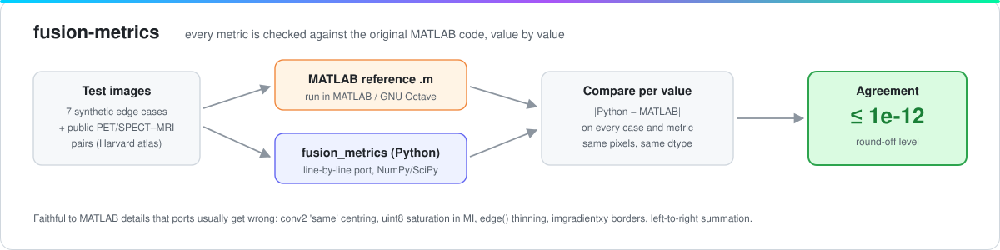

<div align="center">

# fusion-metrics

**Objective quality metrics for image fusion — ported line by line from MATLAB and verified to round-off precision.**

Developed by **[Vu Viet Anh](https://vuvietanh2309.github.io/)** (Vũ Việt Anh) · AI Engineer & Researcher, Hanoi University of Science and Technology

[](https://github.com/VuVietAnh2309/fusion-metrics/actions/workflows/test.yml)
[](https://pypi.org/project/fusion-metrics/)
[](https://doi.org/10.5281/zenodo.24536175)
[](https://github.com/VuVietAnh2309/fusion-metrics/blob/main/LICENSE)


[Quick start](#-quick-start) · [Metrics](#-metrics) · [API docs](https://github.com/VuVietAnh2309/fusion-metrics/blob/main/docs/API.md) · [CLI](#-command-line) · [Verification](#-verification) · [Citation](#-citation) · [Tiếng Việt](https://github.com/VuVietAnh2309/fusion-metrics/blob/main/README.vi.md)

</div>

<picture>
  <source media="(prefers-color-scheme: dark)" srcset="https://raw.githubusercontent.com/VuVietAnh2309/fusion-metrics/main/assets/verification-dark.svg">
  
</picture>

## Why

Image-fusion papers report Q<sup>AB/F</sup>, MI, NCIE, FMI, VIF… but compute them with scattered MATLAB scripts and
ad-hoc Python re-implementations that quietly disagree: a different gray conversion, a one-pixel shift in
`conv2(...,'same')`, `uint8` saturation in a histogram, a different edge-thinning rule. The same method can then
score differently from paper to paper.

`fusion-metrics` gives one reference implementation that anyone can `pip install`:

- **MATLAB-faithful** — each function is a line-by-line port of a reference `.m` file, keeping its name, argument
  order and numerical quirks.
- **Verified, not assumed** — a self-test compares every metric with values produced by the original `.m` files;
  agreement is at round-off level (≤ 1e-12). It runs in CI on Python 3.10–3.13.
- **Ready for benchmarks** — score one image from Python, or a whole method folder from the command line to CSV.

## 🚀 Quick start

```bash
pip install fusion-metrics
```

```python
import fusion_metrics as fm

A = fm.read_gray("MRI.png")     # MATLAB imread + rgb2gray -> uint8
B = fm.read_gray("PET.png")     # pseudo-colour images are converted to gray
F = fm.read_gray("fused.png")

fm.Q_ABF(A, B, F)                       # one metric
fm.evaluate(A, B, F, "information")     # a preset -> {"Q_MI": ..., "Q_NCIE": ..., ...}
fm.evaluate(A, B, F)                    # all 24 metrics
```

## 📐 Metrics

Full API reference with a worked example for every function: [docs/API.md](https://github.com/VuVietAnh2309/fusion-metrics/blob/main/docs/API.md).

`Q_X(A, B, F)` takes the two sources and the fused image; no-reference metrics take only `F`.
Inputs are grayscale `uint8` or `double` in [0, 255].

| Function | Metric | Original reference |
|---|---|---|
| `Q_MLI(F)` | Mean local intensity, [0, 1] | — |
| `Q_En(F)` | Entropy | Roberts et al., *J. Appl. Remote Sens.* 2008 |
| `SF(F)` | Spatial frequency (4 directions) | Eskicioglu & Fisher, *IEEE TCOM* 1995 |
| `Q_AG(F)` | Average gradient (forward differences, [0, 1]) | — |
| `AG_VIFB(F)` | Average gradient, VIFB definition (0–255) | Zhang et al., VIFB, *CVPRW* 2020 |
| `Q_CI(F)` | Contrast index = standard deviation (SD) on [0, 1] | Rao, *Int. J. Remote Sens.* 1997 |
| `Q_EI(F)` | Edge intensity (Sobel), √Σ(Sx²+Sy²) / (M·N) | Rajalingam & Priya, *IJESI* 2018 |
| `Q_MI(A,B,F)` | Mutual information MI(A,F) + MI(B,F), bits | Qu et al., *Electron. Lett.* 2002 |
| `Q_NMI(A,B,F)` | Normalized mutual information | Hossny et al., *Electron. Lett.* 2008 |
| `Q_CE(A,B,F)` | Cross entropy of the histograms (lower = better) | Bulanon et al., *Biosyst. Eng.* 2009 |
| `Q_NCIE(A,B,F)` | Nonlinear correlation information entropy | Wang, Shen & Jin, 2008 |
| `Q_TE_Nava(A,B,F)` | Tsallis entropy, q = 0.43137 | Nava et al., *Proc. SPIE* 2007 |
| `Q_FMI(A,B,F)` | Feature mutual information on edge maps, w = 3 | Haghighat et al., *Comput. Electr. Eng.* 2011 |
| `Q_ABF(A,B,F)` | Edge-based Q<sup>AB/F</sup> | Xydeas & Petrović, *Electron. Lett.* 2000 |
| `Q_M(A,B,F)` | Multiscale edge preservation (Haar, 2 levels) | Wang & Liu, *ICSP* 2008 |
| `Q_SF(A,B,F)` | Relative spatial-frequency error | Zheng et al., *Inf. Fusion* 2007 |
| `Q_FSIM(A,B,F)` | Feature similarity, (FSIM(A,F) + FSIM(B,F)) / 2 | Zhang et al., *IEEE TIP* 2011 |
| `MS_SSIM(A,B,F)` | SSIM, (SSIM(A,F) + SSIM(B,F)) / 2 — single-scale despite the file name | Wang et al., *IEEE TIP* 2004 |
| `Q_UIQI(A,B,F)` | Universal image quality index, (UIQI(A,F) + UIQI(B,F)) / 2 | Wang & Bovik, *IEEE SPL* 2002 |
| `Q_PSNR(A,B,F)` | Mean of PSNR(F,A) and PSNR(F,B) | — |
| `Q_CC(A,B,F)` | Mean correlation coefficient | — |
| `Q_SCD(A,B,F)` | Sum of the correlations of differences | Aslantas & Bendes, *AEU* 2015 |
| `VIF_Sheikh(A,B,F)` | VIF(A,F) + VIF(B,F) | Sheikh & Bovik, *IEEE TIP* 2006 |
| `Q_VIFF(A,B,F)` | Visual information fidelity for fusion | Han et al., *Inf. Fusion* 2013 |

The taxonomy follows Liu et al., *“Objective assessment of multiresolution image fusion algorithms for context
enhancement in night vision”*, IEEE TPAMI 2012. **Please cite the original paper of every metric you report.**

> [!NOTE]
> Two pairs look alike but are different metrics: `Q_AG` vs `AG_VIFB` (different differences and scale), and
> `Q_VIFF` (Han et al.) vs `VIF_Sheikh` (Sheikh & Bovik). State which one you use.
> `Q_CI` (SD) and `Q_EI` work on different scales: `Q_CI` on [0, 1], `Q_EI` on the input scale.
> `Q_UIQI` follows `UIQI.m`, which does not convert its inputs to double: with `uint8` images the products
> inside it saturate at 255 exactly as in MATLAB. Pass `float64` images for the textbook UIQI.

### Presets

| Preset | Metrics |
|---|---|
| `image` | `Q_MLI`, `Q_En`, `Q_CI`, `SF`, `AG_VIFB`, `Q_EI` |
| `information` | `Q_MI`, `Q_NMI`, `Q_NCIE`, `Q_TE_Nava`, `Q_FMI`, `Q_CE` |
| `feature` | `Q_ABF`, `Q_M`, `Q_SF`, `Q_FSIM` |
| `structural` | `MS_SSIM`, `Q_UIQI` |
| `similarity` | `Q_PSNR`, `Q_CC`, `Q_SCD`, `VIF_Sheikh`, `Q_VIFF` |
| `ivif6` | `Q_En`, `Q_CI` (SD), `SF`, `AG_VIFB`, `Q_MI`, `MS_SSIM` — the six statistics most infrared–visible papers report |
| `all` | all 24 |

## 💻 Command line

```bash
# one fused image
fusion-metrics MRI.png PET.png fused.png --preset feature

# a whole method: files matched by name across three folders -> per-image CSV + mean
fusion-metrics --dirs data/MRI data/PET results/MyMethod --preset all --csv mymethod.csv

fusion-metrics --list        # metrics and presets
```

Add `--json` for machine-readable output, or `--reader cv` to use the OpenCV gray conversion instead of MATLAB's.

## ⚠️ Conventions that change the numbers

- **Gray conversion.** `read_gray` reproduces MATLAB `imread` + `rgb2gray` (0.298936, 0.587043, 0.114021, rounded) —
  use it to match MATLAB. `read_gray_cv` uses OpenCV's 0.299 / 0.587 / 0.114, common in Python code bases. Loading with
  `cv2.imread(path, 0)` directly gives yet another result.
- **Data type matters for `Q_MI`.** On `uint8` input MATLAB saturates `255 + 1` to 255, merging the top gray level into
  the previous histogram bin. The port reproduces this from the array's dtype — read images as `uint8`.
- **Data type matters for `Q_UIQI`.** `UIQI.m` does not convert its inputs to double, so on `uint8` images the
  squares and products inside it are `uint8` in MATLAB (rounded and saturated at 255). The port reproduces this from the
  array's dtype; pass `float64` images to get the textbook UIQI.
- **Edge maps for `Q_FMI`.** MATLAB's `edge()` thins edges inside a compiled mex file. The port reproduces its rule
  (non-maximum suppression with `<=` towards the left/upper and `<` towards the right/lower neighbour), which matches
  values computed in MATLAB.
- **Summation order.** `Q_FMI` branches on exact zero tests, so its sums follow MATLAB's left-to-right order;
  NumPy's pairwise summation would shift results by up to 5e-3.

## ✅ Verification

```bash
python verify/selftest.py        # ~20 s, prints "ALL OK"; no MATLAB/Octave needed
```

The self-test scores 7 seeded synthetic cases chosen to hit every code path — structured, noise, saturated 0/255,
low range [0, 40], {0, 1} images, odd size 255×257, and 512×512 — and compares the Python values with those produced by
the original `.m` files in GNU Octave:

- **All 23 checks agree** (the 24 metrics, with `Q_FMI` checked on stored edge maps, plus `Q_UIQI` and `Q_CE` on
  `float64` and [0, 1] inputs) with relative error ≤ 1.7e-12 (most ≈ 1e-15), and `edge_sobel` reproduces the stored
  edge maps pixel for pixel.
- One documented exception: `Q_VIFF` on the *saturated* case differs by 2.7e-5. Its perfectly flat regions put local
  variances at round-off level, right at the `.m` file's 1e-10 thresholds, where the result depends on the summation
  order inside `filter2` (which differs between MATLAB, Octave and SciPy). On real images `Q_VIFF` agrees to 1e-14.

A cross-check on 194 real PET/SPECT–MRI cases from the public Harvard Whole Brain Atlas gave the same picture: every
metric within 4e-12 of the `.m` files on identical pixel arrays.

<details>
<summary><b>Regenerate the reference values (needs GNU Octave)</b></summary>

```bash
conda create -p ./octave -c conda-forge octave octave-image octave-signal
cd verify
python make_reference_cases.py && octave-cli run_reference.m \
  && python selftest.py --export && python selftest.py
```

`verify/octave_shims/` supplies `dwt2` (Haar, MATLAB's default `'sym'` mode — Octave has no Wavelet Toolbox) and
`imgradientxy` with MATLAB's border convention. They are only used when running the `.m` files in Octave.

</details>

## 🗂️ Repository layout

```
fusion-metrics/
├── fusion_metrics/      # the Python package (+ CLI in cli.py)
├── matlab/              # reference .m implementations
├── matlab_added/        # MATLAB references for AG_VIFB and VIF_Sheikh
├── verify/              # self-test, reference cases/values, Octave scripts and shims
├── examples/            # minimal API example
└── assets/              # README figures
```

## 🧭 Roadmap

The `matlab/` folder holds 15 more reference metrics without a Python port yet: `Q_C`, `Q_CB`, `Q_CV`, `Q_CE`, `Q_CI`,
`Q_EI`, `Q_H`, `Q_NMI`, `Q_P`, `Q_S`, `Q_TE`, `Q_UIQI`, `Q_Y`, `Q_NABF`, `MS_SSIM`. Contributions are welcome —
a port is accepted once it passes the self-test against its `.m` file.

## 📝 Citation

If `fusion-metrics` helps your work, please cite it (GitHub's **“Cite this repository”** button gives the same entry)
**and** the original paper of each metric you report:

```bibtex
@software{vu2026fusionmetrics,
  author  = {Vu, Viet Anh},
  title   = {fusion-metrics: MATLAB-faithful objective quality metrics for image fusion},
  year    = {2026},
  version = {1.0.1},
  doi     = {10.5281/zenodo.24536175},
  url     = {https://github.com/VuVietAnh2309/fusion-metrics}
}
```

## 👤 Author

**Vu Viet Anh** (Vũ Việt Anh) — author and maintainer of the Python package, CLI and verification suite.<br/>
AI Engineer & MSc student in Computer Science, Hanoi University of Science and Technology (HUST).

[](mailto:vietanhresearcher@gmail.com)
[](https://orcid.org/0009-0006-6977-5922)
[](https://vuvietanh2309.github.io/)
[](https://github.com/VuVietAnh2309)

## 📄 License

The package is MIT-licensed. `Q_FSIM`, `Q_VIFF` and `VIF_Sheikh` are translations of third-party code that remains
under its authors' terms (educational and research use only) — see [NOTICE](https://github.com/VuVietAnh2309/fusion-metrics/blob/main/NOTICE). Reference `.m` files keep their
original copyright headers.

The `.m` files in `matlab/` are the reference implementations used for verification; files derived from published
toolboxes keep their original headers.

Questions: [Discussions](https://github.com/VuVietAnh2309/fusion-metrics/discussions) · bugs and new metric ports: [Issues](https://github.com/VuVietAnh2309/fusion-metrics/issues) · contributing: [CONTRIBUTING.md](https://github.com/VuVietAnh2309/fusion-metrics/blob/main/CONTRIBUTING.md).
